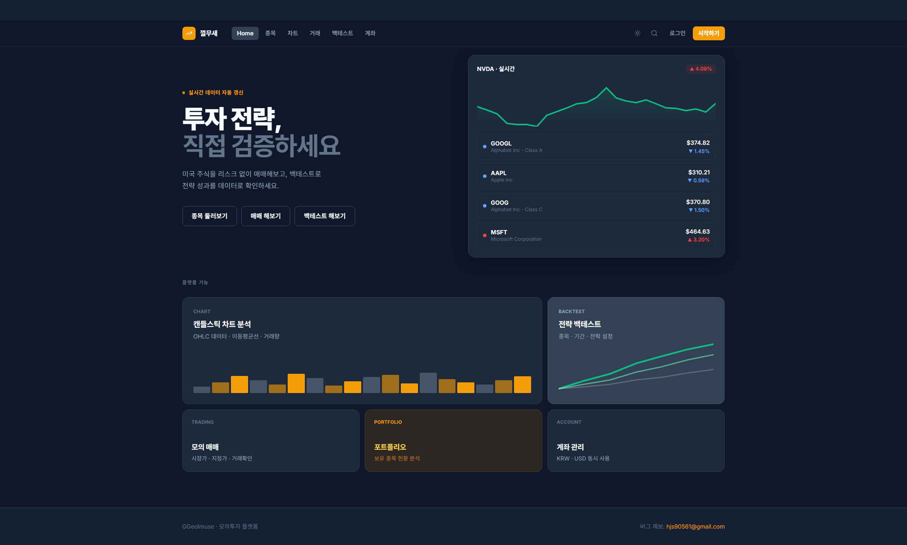
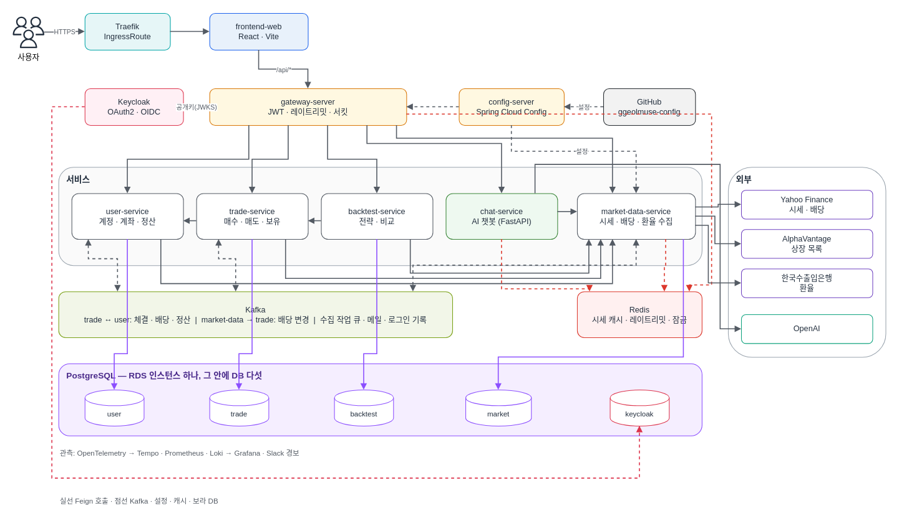
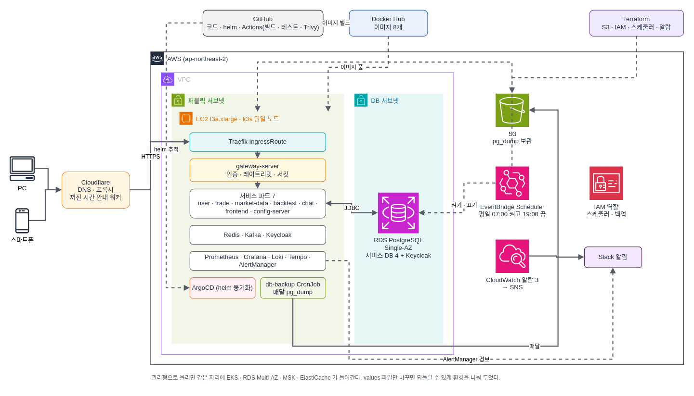

# GGeolmuse

> 미국 주식 데이터로 투자 전략을 백테스팅하는 마이크로서비스 플랫폼

**Live Demo**: https://ggeolmuse.com — 평일 07:30~19:00 (KST) 에만 띄워둡니다

[](https://github.com/musqat/ggeolmuse/actions)
[](https://github.com/musqat/ggeolmuse/actions)

<div align="center">
  
</div>

> 야간·주말은 내려둡니다. 꺼져 있는 동안 접속하면 다음 가동 시각을
> 안내하는 페이지가 뜹니다 ([Cloudflare Worker](cloudflare/offline-notice/worker.js)).

<br>

## 하는 일

NYSE · NASDAQ · NYSE ARCA 상장 12,000+ 종목의 일별 가격으로 투자 전략을 검증한다.
환율 변동, 배당 재투자, 거래 수수료까지 반영해 실제 매매에 가까운 수익률을 낸다.

```
종목 · 기간 · 전략 선택
        ↓
전략 실행   단순 매수 / 적립식 / 조건부 매매
        ↓
보정        환율(KRW↔USD) · 배당 재투자 · 수수료
        ↓
결과        수익률 · 자산 추이 · 전략 간 비교
```

<details>
<summary><b>기능 목록</b></summary>

<br>

- 일별 시세(평일 아침 수집)와 과거 OHLC 데이터 제공
- 투자 전략 다섯 가지 (단순, 적립식, 조건부 매매, 전략 비교, 종목 비교)
- 환율을 반영한 원화·달러 수익률
- 배당금 자동 재투자 시뮬레이션
- 최적 매수 · 매도 시점 — 원화 주가(종가 × 그날 환율) 기준
- 거래 수수료 반영. 모의 매매는 슬리피지까지
- AI 종목 대화 — 기술 지표 · 주가 추이 · 배당을 묻는 챗봇, 차트에서 원클릭

</details>

<br>

## 구조

서비스 일곱 개(Java 6 + Python 1). 서비스별 독립 배포와 스케일링을 다뤄보는 것이 목적이고
**실제 운영은 단일 EC2 한 대**다.

```
                    Traefik IngressRoute
                            │
                    Gateway Server (8070)
         JWT 검증 · 라우팅 · Rate Limit · Circuit Breaker
                            │
     ┌──────────┬───────────┼───────────┬──────────┐
     ▼          ▼           ▼           ▼          ▼
   User       Trade      Backtest   Market-Data   Chat
   8080       8081        8082        8083       8000
  인증·계좌   거래·포트폴리오  전략 시뮬  시세 수집·제공  AI 분석
     │          │           │           │
     └──────────┴─────┬─────┴───────────┘
                      │
        PostgreSQL · Redis · Kafka
```

Feign 은 답이 있어야 다음 줄이 진행되는 조회에 쓰고 Kafka 는 답이 필요 없는 사후 통지에 쓴다.
설정은 Config Server 가 [ggeolmuse-config](https://github.com/musqat/ggeolmuse-config) 에서
읽어 배포한다. 코드와 분리해 둬서 cron 이나 수집 상한 같은 값은 재배포 없이 바꾼다.

<details>
<summary><b>서비스별 상세</b> — 각 서비스 README</summary>

<br>

| Service | 역할 | |
|---|---|---|
| **Config Server** | 중앙 설정 관리 | [📄](backend/config-server/README.md) |
| **Gateway Server** | 라우팅, JWT 검증, Rate Limit | [📄](backend/gateway-server/README.md) |
| **User Service** | 인증, 계좌 관리, 환전 | [📄](backend/user-service/README.md) |
| **Trade Service** | 거래 실행, 포트폴리오 | [📄](backend/trade-service/README.md) |
| **Market Data Service** | 시세 수집·제공 | [📄](backend/market-data-service/README.md) |
| **Backtest Service** | 전략 백테스팅 | [📄](backend/backtest-service/README.md) |
| **Chat Service** | AI 종목 대화 (FastAPI) | [📄](backend/chat-service/README.md) |

인프라 구성은 [helm/README.md](helm/README.md) 에 있다.
서비스 설정은 별도 저장소 [ggeolmuse-config](https://github.com/musqat/ggeolmuse-config) 에 있다.

</details>

<details>
<summary><b>디렉터리</b></summary>

<br>

```
ggeolmuse/
├── backend/
│   ├── gateway-server/       API Gateway (WebFlux)
│   ├── config-server/        중앙 설정
│   ├── user-service/         인증 · 계좌
│   ├── trade-service/        거래 · 포트폴리오
│   ├── market-data-service/  시세 수집 · 제공
│   ├── backtest-service/     전략 시뮬레이션
│   ├── chat-service/         AI 종목 대화 (FastAPI)
│   ├── ggeolmuse-bom/        의존성 버전 (BOM)
│   ├── ggeolmuse-common/     공통 라이브러리 (예외 · 로깅 · 유틸)
│   └── messaging/            Kafka 공통 라이브러리
├── frontend-web/         React
├── docker-compose/       로컬 스택
├── cloudflare/           꺼져 있을 때 안내 페이지 (Worker)
├── helm/                 Helm 차트 · ArgoCD
├── tests/
│   ├── e2e/              Playwright
│   └── k6/               부하 테스트 스크립트
└── terraform/            EC2 · RDS 스케줄러 · 알람
```





</details>

<br>

## 기술 스택

| 영역 | 기술 |
|---|---|
| Backend | Java 21 · Spring Boot 3.5 · Spring Cloud Gateway · Spring Security |
| AI | FastAPI (Python) · OpenAI gpt-4o / gpt-4o-mini |
| Data | PostgreSQL · Redis · Kafka |
| Frontend | React · TypeScript · Vite |
| Auth | Keycloak (OAuth2 / JWT) |
| Resilience | Resilience4j — CircuitBreaker · Retry · TimeLimiter · Bulkhead |
| Infra | Kubernetes (K3s) · Helm · ArgoCD · Docker |
| 관측 | Prometheus · Grafana · Tempo (OpenTelemetry) · Loki |
| Test | JUnit 5 · Mockito · Testcontainers · Vitest · Playwright · k6 |

<br>

## 테스트

백엔드 **1,467 개**, 프론트 **481 개**, E2E **41 개**.

| 서비스 | 테스트 |
|---|---|
| market-data-service | 507 |
| user-service | 363 |
| backtest-service | 293 |
| trade-service | 253 |
| ggeolmuse-common | 32 |
| messaging | 19 |
| frontend-web | 481 |
| E2E (Playwright) | 41 |

E2E 는 `docker compose` 로 스택 전체를 띄우고 PR 과 `master` push 마다 돈다.
필수 체크로 두지 않은 이유는 시세를 Yahoo Finance 에서 받아서다 — 코드와
무관하게 외부가 흔들리면 머지가 막힌다.

<details>
<summary><b>커버리지와 그 한계</b></summary>

<br>

단위 · 통합 테스트 수치다(user 는 통합 테스트가 없다). `Q*`, `*Config`, DTO, entity 와 롬복이 만든
코드(게터 · 빌더 · equals)는 뺀다. 롬복 코드는 `backend/lombok.config` 가 붙이는 표시로 JaCoCo 가 건너뛴다.
네 서비스 모두 CI 에서 바닥 아래로 내려가면 빌드를 막는다. 바닥은 네 서비스 모두 라인 90 · 분기 80 이다(%).

| 서비스 | 라인 | 분기 |
|---|---|---|
| user | 98.4% | 86.5% |
| trade | 99.4% | 92.2% |
| backtest | 98.3% | 88.3% |
| market-data | 97.7% | 87.3% |

market-data 의 외부 호출(야후 · NASDAQ · 수출입은행 · AlphaVantage)은 실제 네트워크 없이 RestTemplate 응답을 흉내 내
테스트한다.

프론트 테스트는 화면 개수가 아니라 **실제로 틀렸던 곳**을 기준으로 골랐다.
`toISOString()` 이 UTC 라 날짜가 밀리던 것 같은 결함들이고
전부 [문제 해결](docs/problem-solving.md) 에 기록돼 있다.

</details>

<br>

## 성능

[성능 튜닝](docs/performance-tuning.md) 에 적었다. 수치마다 잰 조건을 붙였다.

운영 부하는 2026-10-21 에 1.5.1 로 쟀다. 같은 VPC 의 c5.xlarge 에서 k6 VU 50 으로, Traefik → 게이트웨이 → market-data 를
그대로 거쳤다.

| 부하 | 처리량 | p95 | p99 |
|---|---|---|---|
| 다섯 경로 섞어서(데운 뒤) | 64.8 rps | 1.64초 | 2.05초 |
| 시세 하나만 | 약 200 rps(IP 당 한도) | 274ms | 321ms |
| 일자별 OHLC 하나만 | 약 194 rps(IP 당 한도) | 282ms | 330ms |
| 전체 종목 목록 하나만 | 24.4 rps | 1.99초 | 2.18초 |

부하 중 게이트웨이와 market-data 가 CPU 한도(0.6 · 0.7코어)에 붙었다. 처리량의 상한은 이 한도다. 처음 걸었을 때는
게이트웨이 서킷이 열려 모두가 503 을 받았고, 그 경위는 [문제 해결](docs/problem-solving.md#부하-테스트에-게이트웨이-서킷이-열려-모두가-503-을-받았다) 에 있다.

<br>

## 운영

**구성 등급** — 관리형 서비스로 짜면 EKS, RDS Multi-AZ, MSK, ElastiCache 가 된다.
아키텍처는 그대로 두고 운영 등급만 낮췄다. EKS→K3s, RDS Multi-AZ→Single-AZ,
MSK·ElastiCache→파드 내 실행. values 파일만 바꾸면 되돌릴 수 있게 환경을 분리했다.

**데이터** — 상장 목록을 받아오면 14,000 개가 넘게 잡힌다. 상장폐지된 것은 지우지 않고
`active=false` 로 내린다. 수집 스케줄러는 `active=true` 인 12,000+ 만 갱신한다.

**가동 시간** — EventBridge Scheduler 가 EC2 를 평일 07:00 에 켜고 19:00 에 끈다.
앱이 뜨는 데 5~10분 걸려서 방문자 기준은 07:30 이다.

<details>
<summary><b>배포와 관측</b></summary>

<br>

```
GitHub Actions          빌드 · 테스트 · Trivy 스캔
        ↓
ArgoCD (GitOps)         Helm 차트를 추적해 동기화
        ↓
K3s (EC2 단일 노드)      Traefik IngressRoute 로 진입
```

| 도구 | 용도 |
|---|---|
| Prometheus · Grafana | 메트릭 수집과 시각화 |
| Tempo · OpenTelemetry | 분산 추적 |
| Loki | 로그 집계 |
| ArgoCD | GitOps 배포 |

로컬 `docker-compose` 로는 Prometheus · Grafana · Tempo 를 띄운다. Loki 는 클러스터에만 있다.

**안정성** — Resilience4j 로 CircuitBreaker · Retry · TimeLimiter · Bulkhead 를 걸었다.
서킷은 market-data 를 내렸다 올리며 OPEN → CLOSED 전이를 실제로 확인했다.

</details>

<br>

## 로컬에서 실행

Docker Desktop 이 떠 있으면 한 번에 올라간다.

```bash
git clone https://github.com/musqat/ggeolmuse.git
cd ggeolmuse
bash docker-compose/local-up.sh
```

접속은 http://localhost:3000, 시드 계정은 `admin@test.com` / `Admin123!` 이다.
AI 챗봇 설정과 주의할 점은 [빌드와 배포](docs/DEPLOY.md) 에 적었다.

<br>

## 만들며 겪은 것

- [시행착오](docs/trial-and-error.md) — 근거를 갖고 정한 것이 확인해보니 반대인 게 여럿이었다. 믿었던 것과 갈린 근거
- [문제 해결](docs/problem-solving.md) — 겪은 장애와 버그를 문제 → 원인 → 해결. 감수하기로 한 한계도 함께
- [성능 튜닝](docs/performance-tuning.md) — 성능 튜닝한 기록. 수치마다 잰 조건을 붙였다
