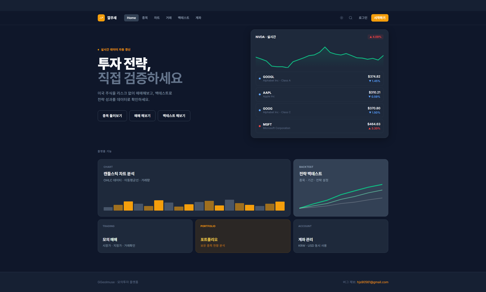
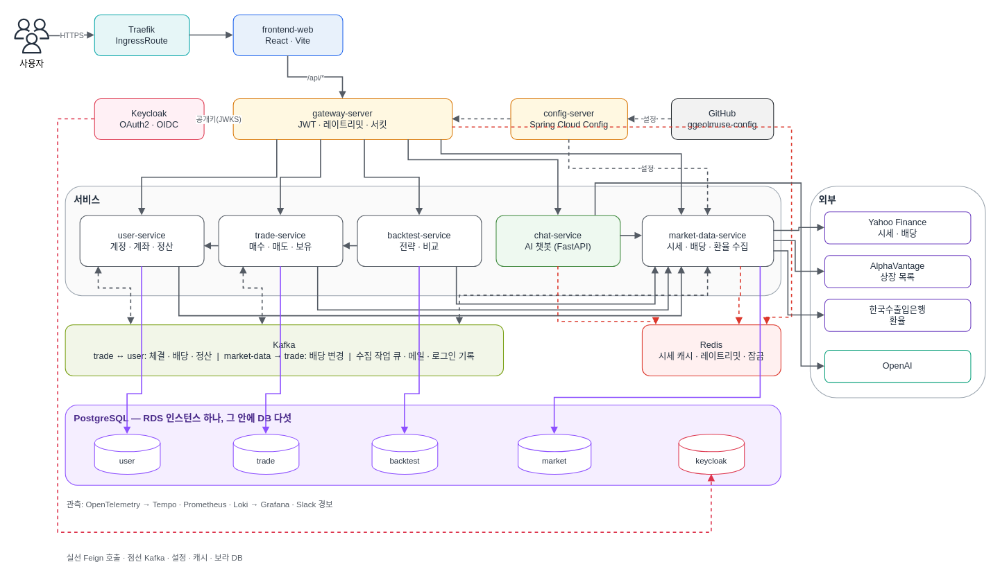
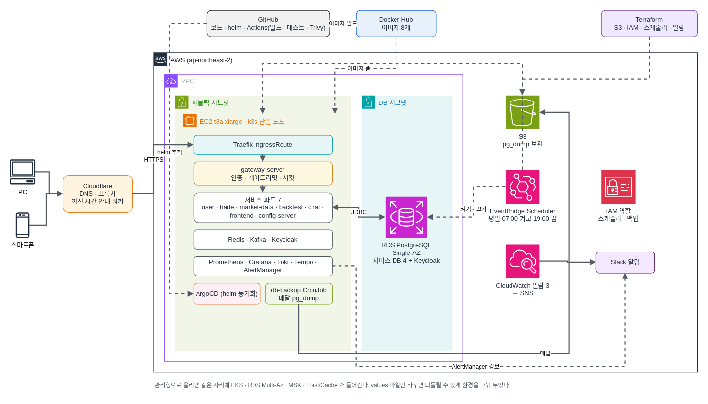

# GGeolmuse

> 미국 주식 데이터로 투자 전략을 백테스팅하는 마이크로서비스 플랫폼

**Live Demo**: https://ggeolmuse.com — 평일 07:30~19:00 (KST) 에만 띄워둡니다

[](https://github.com/musqat/ggeolmuse/actions)
[](https://github.com/musqat/ggeolmuse/actions)

<div align="center">
  
</div>

> 야간·주말은 내려둡니다. 꺼져 있는 동안 접속하면 다음 가동 시각을
> 안내하는 페이지가 뜹니다.

<br>

## 하는 일

NYSE · NASDAQ · NYSE ARCA 상장 12,000+ 종목의 일별 가격으로 투자 전략을 검증한다.
환율 변동, 배당 재투자, 거래 수수료, 양도세까지 반영해 실제 매매에 가까운 수익률을 낸다.

```
종목 · 기간 · 전략 선택
        ↓
전략 실행   단순 매수 / 적립식 / 조건부 매매 / 이동평균 교차 · 밴드 / 포트폴리오
        ↓
보정        환율(KRW↔USD) · 배당 재투자 · 수수료 · 양도세
        ↓
결과        수익률 · 자산 추이 · 전략 간 비교
```

<details>
<summary><b>기능 목록</b></summary>

<br>

- 일별 시세(평일 아침 수집)와 과거 OHLC 데이터 제공
- 투자 전략 여덟 가지 (단순, 적립식, 조건부 매매, 이동평균 교차, 이동평균 밴드, 포트폴리오, 전략 비교, 종목 비교)
- 적립식 주기(매일 · 매주 · 매달 · N개월마다)와 첫 매수일
- 금액 대신 주식 수로 사기, 적립식 · 조건부 예산 한도
- 조건부 매매의 익절 · 손절 — 평균 단가 기준으로 전량 매도
- 이동평균 교차 — 짧은 선이 긴 선을 위로 넘으면 가진 돈 전부로 매수, 아래로 넘으면 전량 매도, 결과에 종가 · 두 이동평균선 · 교차 점 차트
- 이동평균 밴드 — 수정 종가가 N일 평균보다 정한 비율 위로 오르면 가진 돈 전부로 매수, 정한 비율 아래로 내려가면 전량 매도(기본 200일 · ±2.5%), 결과에 평균선 · 위 · 아래 선 · 매매 점 차트
- 이동평균 · 밴드의 신호 종목 — S&P 500 · 나스닥 100 지수나 다른 종목의 선으로 사고팔 날을 정하고, 매매 종목은 그 날짜(쉬는 날이면 다음 거래일) 종가에 사고팖
- 조건부 · 이동평균 · 밴드의 고점 대비 하락 매도 — 종가가 고점에서 정한 비율만큼 내리면 보유의 정한 몫을 팔고, 이동평균 · 밴드는 다 판 뒤 새 매수 신호에서 다시 매수
- 조건부 · 이동평균 · 밴드의 부분 익절 — 종가가 평균 단가보다 단계마다 정한 수익률만큼 오르면 보유의 정한 몫을 팖(5단계까지, 단계마다 산 날부터 전부 판 날까지 한 번)
- 조건부 · 이동평균 · 밴드 결과의 매매 통계 — 산 날부터 전부 판 날까지를 한 번으로 보고 승률 · 평균 익절 · 손절 · 손익비 · 연평균 거래 · 평균 보유 기간
- 포트폴리오 — 종목 10개까지 금액이나 총액 · 비율로 나누고 종목마다 한 번에 · 적립식 · 이동평균 교차 · 밴드 가운데 하나로 사고팔아 현금 하나로 평가, 매년 · 분기마다 · 매달 처음 비중으로 리밸런싱(이동평균 · 밴드 종목은 빼고), 종목마다 평균 단가 기준 익절 · 손절, 결과에 합친 자산 · 종목별 기여 · 처음과 지금 비중, 판 것이 있으면 매매 내역 · 실현 손익 · 양도세
- 해외 주식 양도세(연 250만원 공제 · 22%) — 다음 해 5월 현금에서 냄, 세후 수익률과 기간 끝 전량 매도 선택
- 환율을 반영한 원화·달러 수익률
- 배당금 자동 재투자 시뮬레이션
- 최적 매수 · 매도 시점 — 원화 주가(종가 × 그 날짜 환율) 기준
- 거래 수수료 반영. 모의 매매는 슬리피지까지
- AI 종목 대화 — 기술 지표 · 주가 추이 · 배당을 묻는 챗봇, 차트에서 원클릭

</details>

<br>

## 구조

서비스 일곱 개(Java 6 + Python 1). 서비스별 독립 배포와 스케일링을 다뤄보는 것이 목적이고
**실제 운영은 단일 EC2 한 대**다.

```
                    Traefik IngressRoute
                            │
                    Gateway Server (8070)
         JWT 검증 · 라우팅 · Rate Limit · Circuit Breaker
                            │
     ┌──────────┬───────────┼───────────┬──────────┐
     ▼          ▼           ▼           ▼          ▼
   User       Trade      Backtest   Market-Data   Chat
   8080       8081        8082        8083       8000
  인증·계좌   거래·포트폴리오  전략 시뮬  시세 수집·제공  AI 분석
     │          │           │           │
     └──────────┴─────┬─────┴───────────┘
                      │
        PostgreSQL · Redis · Kafka
```

Feign 은 답이 있어야 다음 줄이 진행되는 조회에 쓰고 Kafka 는 답이 필요 없는 사후 통지에 쓴다.
설정은 Config Server 가 [ggeolmuse-config](https://github.com/musqat/ggeolmuse-config) 에서
읽어 배포한다. 코드와 분리해 둬서 cron 이나 수집 상한 같은 값은 재배포 없이 바꾼다.

<details>
<summary><b>서비스별 상세</b> — 각 서비스 README</summary>

<br>

| Service | 역할 | |
|---|---|---|
| **Config Server** | 중앙 설정 관리 | [📄](backend/config-server/README.md) |
| **Gateway Server** | 라우팅, JWT 검증, Rate Limit | [📄](backend/gateway-server/README.md) |
| **User Service** | 인증, 계좌 관리, 환전 | [📄](backend/user-service/README.md) |
| **Trade Service** | 거래 실행, 포트폴리오 | [📄](backend/trade-service/README.md) |
| **Market Data Service** | 시세 수집·제공 | [📄](backend/market-data-service/README.md) |
| **Backtest Service** | 전략 백테스팅 | [📄](backend/backtest-service/README.md) |
| **Chat Service** | AI 종목 대화 (FastAPI) | [📄](backend/chat-service/README.md) |

인프라 구성은 [helm/README.md](helm/README.md) 에 있다.
서비스 설정은 별도 저장소 [ggeolmuse-config](https://github.com/musqat/ggeolmuse-config) 에 있다.

</details>

<details>
<summary><b>디렉터리</b></summary>

<br>

```
ggeolmuse/
├── backend/
│   ├── gateway-server/       API Gateway (WebFlux)
│   ├── config-server/        중앙 설정
│   ├── user-service/         인증 · 계좌
│   ├── trade-service/        거래 · 포트폴리오
│   ├── market-data-service/  시세 수집 · 제공
│   ├── backtest-service/     전략 시뮬레이션
│   ├── chat-service/         AI 종목 대화 (FastAPI)
│   ├── ggeolmuse-bom/        의존성 버전 (BOM)
│   ├── ggeolmuse-common/     공통 라이브러리 (예외 · 로깅 · 유틸)
│   └── messaging/            Kafka 공통 라이브러리
├── frontend-web/         React
├── docker-compose/       로컬 스택
├── cloudflare/           꺼져 있을 때 안내 페이지 (Worker)
├── helm/                 Helm 차트 · ArgoCD
├── k8s/                  멀티 노드 예비안 (부트스트랩 · kind)
├── tests/
│   ├── e2e/              Playwright
│   └── k6/               부하 테스트 스크립트
└── terraform/            EC2 · RDS 스케줄러 · 알람
```

서비스 안 패키지는 두 가지다. 독립된 기능이 둘인 user-service 는 기능별(`domain/account` · `domain/user` 아래 controller · dto · entity ·
repository · service)이고, 기능 하나를 단계로 나누는 trade · market-data · backtest 는 계층별(`api/controller`, `domain/dto` · `entity` ·
`repository` · `service`)이다. 서비스마다 `PackageLayoutTest` 가 이 모양을 지킨다.





</details>

<br>

## 기술 스택

| 영역 | 기술 |
|---|---|
| Backend | Java 21 · Spring Boot 3.5 · Spring Cloud Gateway · Spring Security |
| AI | FastAPI (Python) · OpenAI gpt-4o / gpt-4o-mini |
| Data | PostgreSQL · Redis · Kafka |
| Frontend | React · TypeScript · Vite |
| Auth | Keycloak (OAuth2 / JWT) |
| Resilience | Resilience4j — CircuitBreaker · Retry · TimeLimiter · Bulkhead |
| Infra | Kubernetes (K3s) · Helm · ArgoCD · Docker |
| 관측 | Prometheus · Grafana · Tempo (OpenTelemetry) · Loki |
| Test | JUnit 5 · Mockito · Testcontainers · Vitest · Playwright · k6 |

<br>

## 테스트

백엔드 **2,531 개**, 프론트 **1,517 개**, E2E **68 개**.

| 서비스 | 테스트 |
|---|---|
| market-data-service | 559 |
| user-service | 440 |
| backtest-service | 875 |
| trade-service | 412 |
| gateway-server | 21 |
| config-server | 5 |
| ggeolmuse-common | 36 |
| messaging | 25 |
| chat-service | 158 |
| frontend-web | 1,517 |
| E2E (Playwright) | 68 |

E2E 는 `docker compose` 로 스택 전체를 띄우고 PR 과 `master` push 마다 돈다.
필수 체크로 두지 않은 이유는 시세를 Yahoo Finance 에서 받아서다 — 코드와
무관하게 외부가 흔들리면 머지가 막힌다.

<details>
<summary><b>커버리지와 그 한계</b></summary>

<br>

자바 서비스는 `Q*` · `*Config` · DTO · entity · 롬복이 만든 코드를 뺀 값이다. 최소 커버리지는 모든 서비스가 라인 90 · 분기 80 이고,
CI 에서 그 아래면 빌드를 실패시킨다(자바 JaCoCo · chat `tools/cmd/chat-coverage` · frontend-web vitest).

| 서비스 | 라인 | 분기 |
|---|---|---|
| user | 98.3% | 87.5% |
| trade | 99.5% | 96.4% |
| backtest | 98.9% | 93.7% |
| market-data | 97.9% | 88.2% |
| chat | 98.4% | 89.6% |
| frontend-web | 94.3% | 88.7% |

market-data 의 외부 API 호출은 응답을 흉내 낸 테스트라 실제 API 가 바뀌는 것은 못 잡는다.

</details>

<br>

## 성능

[성능 튜닝](docs/performance-tuning.md) 에 적었다. 수치마다 잰 조건을 함께 적었다.

운영 부하는 2026-10-21 에 1.5.1 로 쟀다. 같은 VPC 의 c5.xlarge 에서 k6 VU 50 으로, Traefik → 게이트웨이 → market-data 를
그대로 거쳤다.

| 부하 | 처리량 | p95 | p99 |
|---|---|---|---|
| 다섯 경로 섞어서(웜업 뒤) | 64.8 rps | 1.64초 | 2.06초 |
| 시세 하나만 | 약 200 rps(IP 당 한도) | 274ms | 321ms |
| 일자별 OHLC 하나만 | 약 194 rps(IP 당 한도) | 282ms | 330ms |
| 전체 종목 목록 하나만 | 24.4 rps | 1.99초 | 2.18초 |

부하 중 게이트웨이와 market-data 가 CPU 한도(0.6 · 0.7코어)까지 찼다. 처리량의 상한은 이 한도다. 처음 걸었을 때는
게이트웨이 서킷이 열려 모두가 503 을 받았고, 그 경위는 [문제 해결](docs/problem-solving.md#부하-테스트에-게이트웨이-서킷이-열려-모두가-503-을-받았다) 에 있다.

<br>

## 운영

**구성 등급** — 관리형 서비스로 짜면 EKS, RDS Multi-AZ, MSK, ElastiCache 가 된다.
아키텍처는 그대로 두고 운영 등급만 낮췄다. EKS→K3s, RDS Multi-AZ→Single-AZ,
MSK·ElastiCache→파드 내 실행. values 파일만 바꾸면 되돌릴 수 있게 환경을 분리했다.

**데이터** — 상장 목록을 받아오면 14,000 개가 넘게 잡힌다. 상장폐지된 것은 지우지 않고
`active=false` 로 내린다. 수집 스케줄러는 `active=true` 인 12,000+ 만 갱신한다.

**가동 시간** — EventBridge Scheduler 가 EC2 를 평일 07:00 에 켜고 19:00 에 끈다.
앱이 뜨는 데 5~10분 걸려서 방문자 기준은 07:30 이다.

<details>
<summary><b>배포와 관측</b></summary>

<br>

```
GitHub Actions          빌드 · 테스트 · Trivy 스캔(PR)
        ↓
GitHub Actions 릴리스    CI 초록 뒤 PR 에서 체크한 서비스 가운데 바뀐 것만 push, 운영 태그 커밋
        ↓
ArgoCD (GitOps)         Helm 차트를 추적해 동기화
        ↓
K3s (EC2 단일 노드)      Traefik IngressRoute 로 진입
```

| 도구 | 용도 |
|---|---|
| Prometheus · Grafana | 메트릭 수집과 시각화 |
| Tempo · OpenTelemetry | 분산 추적 |
| Loki | 로그 집계 |
| ArgoCD | GitOps 배포 |

로컬 `docker-compose` 로는 Prometheus · Grafana · Tempo 를 띄운다. Loki 는 클러스터에만 있다.

**안정성** — Resilience4j 로 CircuitBreaker · Retry · TimeLimiter · Bulkhead 를 걸었다.
서킷은 market-data 를 내렸다 올리며 OPEN → CLOSED 전이를 실제로 확인했다.

</details>

<br>

## 보안

<details>
<summary><b>전송 · 인증 · 요청 상한 · 응답 · 파드 · 공급망</b></summary>

<br>

**전송** — 브라우저에서 EC2 까지 전 구간이 HTTPS 다. Cloudflare 는 Full (strict) 로 EC2 의 Cloudflare Origin CA 인증서를 검증하고,
EC2 는 Cloudflare 대역에서 온 요청만 받는다. Keycloak 은 Traefik 이 넘긴 전달 헤더로 https 요청을 구분해 쿠키에 Secure 속성을 넣는다.

**인증** — Keycloak 이 토큰을 발급하고, 게이트웨이가 서명 · 만료와 함께 발급자(`iss`)와 발급 클라이언트(`azp`)를 허용 목록으로 검사한다.
user · trade · market-data · backtest 도 리소스 서버로 다시 검증한다. access token 은 15분이다. refresh token 은 httpOnly 쿠키로 주고,
재발급할 때마다 새것으로 바꿔 옛것은 다시 쓰지 못한다.

**요청 상한** — 게이트웨이가 Redis 토큰 버킷으로 경로마다 상한을 둔다. 시세 조회는 초당 200, 백테스트는 요청 하나에 토큰 10개라 초당 50,
로그인 · 비밀번호 찾기는 10초에 한 번꼴(연속 세 번)이다. 버킷은 Cloudflare 가 넣은 실 클라이언트 IP(`CF-Connecting-IP`)와 경로로 나눈다.
EC2 는 Cloudflare 대역에서 온 요청만 받아서 밖에서 이 헤더를 지어 넣을 수 없다. 경로를 키에 넣은 이유는
[문제 해결](docs/problem-solving.md#로그인-한-번이-다른-라우트의-토큰을-깎았다) 에, 이 헤더를 쓰는 이유는
[같은 문서](docs/problem-solving.md#레이트-리밋-버킷이-운영에서는-여전히-하나였다) 에 있다.

**응답 · 로그** — 로그인 실패는 가입 여부와 상관없이 같은 401 이다([가입 여부 노출](docs/problem-solving.md#로그인-응답이-가입-여부를-드러냈다)).
로그의 이메일은 가린다.

**브라우저** — nginx 가 CSP · X-Frame-Options · X-Content-Type-Options(nosniff) · Referrer-Policy 를 응답에 넣는다.

**운영 도구** — Kafka UI · Keycloak 관리 콘솔 · Grafana · ArgoCD 는 Cloudflare Access 뒤에 있어 허용한 계정만 들어간다.
Kafka UI 는 그 안에서 로그인 폼을 한 번 더 거치고, 읽기 전용이라 토픽 · 메시지 · 클러스터 설정을 바꾸지 못한다.

**파드 · 비밀값** — 앱 파드는 공용 securityContext 로 비root(10001) · 읽기 전용 루트 · 권한 상승 금지 · capabilities 전부 제거로 돈다.
비밀값은 AWS Secrets Manager 에서 ExternalSecret 으로 받아 파드마다 자기 키만 `/etc/secrets` 파일로 넣는다. 환경변수에는 비밀값이 없다.
노드 IAM 역할은 시크릿 둘(앱 · Origin 인증서)의 읽기만 갖고, 앱 파드는 NetworkPolicy 로 인스턴스 메타데이터(노드 역할 자격증명)에 닿지 않는다.
Redis 에는 비밀번호를 건다.

**공급망** — CI 가 이미지와 매니페스트를 Trivy 로 검사해 CRITICAL · HIGH 를 GitHub Security 탭에 올린다. 빌드를 막지는 않고 보고만 한다.

</details>

<br>

## 로컬에서 실행

Docker Desktop 이 떠 있으면 한 번에 올라간다.

```bash
git clone https://github.com/musqat/ggeolmuse.git
cd ggeolmuse
bash docker-compose/local-up.sh
```

접속은 http://localhost:3000, 시드 계정은 `admin@test.com` / `Admin123!` 이다.
AI 챗봇 설정과 주의할 점은 [빌드와 배포](docs/DEPLOY.md) 에 적었다.

<br>

## 만들며 겪은 것

- [시행착오](docs/trial-and-error.md) — 근거를 갖고 정한 것이 확인해보니 반대인 게 여럿이었다. 믿었던 것과 갈린 근거
- [문제 해결](docs/problem-solving.md) — 겪은 장애와 버그를 문제 → 원인 → 해결. 감수하기로 한 한계도 함께
- [성능 튜닝](docs/performance-tuning.md) — 성능 튜닝한 기록. 수치마다 잰 조건을 함께 적었다
