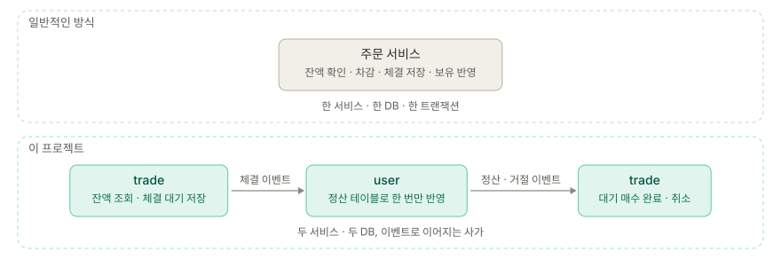

# 설계 결정 0001 — 계좌 잔액은 user-service, 체결은 trade-service 에 둔다

## 일반적인 방식

잔액과 주문 · 체결을 한 서비스 · 한 DB 에 둔다. 매수 한 건이 "잔액 확인 → 차감 → 체결 저장 → 보유 반영" 한 트랜잭션으로 끝나
서비스 사이 실패가 없다.

## 이 프로젝트

잔액 · 환전 · 체결 정산 · 배당 정산 · 계좌 이력은 user-service, 체결 · 보유 · 수익 흐름은 trade-service 에 둔다. 매수는 사가로 끝낸다.

1. trade 가 user 에 잔액을 묻는다(Feign, 서킷 브레이커 · 재시도)
2. trade 가 체결을 대기(`PENDING`)로 저장하고 커밋 뒤 `trading.trade.completed` 를 보낸다(브로커 확인까지 기다림)
3. user 가 정산 테이블로 같은 체결을 한 번만 반영하고 `user.trade.settled` 또는 `user.trade.rejected` 를 보낸다
4. trade 가 대기 매수를 완료하거나 취소한다

매도는 바로 완료로 저장하고 대금은 같은 체결 이벤트로 user 가 더한다.

| 끊긴 곳 | 처리 |
|---|---|
| 잔액 조회 실패(user 꺼짐) | 주문을 받지 않는다(`USER_SERVICE_ERROR`) |
| 체결 저장 뒤 이벤트 전송 실패 | 30초마다 못 보낸 체결을 다시 보내고, 그 수를 지표 `trade.events.unpublished` 로 낸다 |
| 같은 체결을 두 번 받음 | user 의 정산 테이블이 체결마다 한 번만 반영한다 |
| 잔액 조회 뒤 다른 주문이 먼저 씀 | user 가 거절하고 trade 가 대기 매수를 취소한다 |
| 정산 응답이 오지 않음 | 오래 대기한 매수를 다시 보내고, 그 수를 지표 `trade.buys.pending` 으로 낸다 |
| 소비 실패 | 1초 간격 세 번 다시 시도한 뒤 DLT 로 보낸다 |

## 이유

서비스별 배포 · 스케일링과 서비스 사이 실패를 운영 경로에서 다루려고 나눴다. 계좌 조회 · 환전 · 로그인은 user 가, 주문은 trade 가 따로
받아 주문이 몰려도 계좌 화면은 느려지지 않고 trade 가 멈춰도 잔액 · 환전 · 계좌 이력은 보인다.

## 트레이드오프

- 매수 한 건이 두 서비스 · 두 DB 에 걸쳐 정산이 끝날 때까지 대기 매수가 잠깐 보인다
- 정산 테이블 · 재발행 스케줄러 · 보상 · 손 보정 경로(보유 다시 만들기 관리자 API)를 둔다
- 잔액을 동기로 물어 user 가 멈추면 주문도 멈춘다
- 부하를 나눠 얻는 몫을 잰 기록(k6)은 아직 없다

## 일반적인 방식으로 바꿀 때

- 정산 · 보상 코드가 기능보다 더 자주 바뀔 때, 또는 대기 매수를 없애고 바로 체결로 보여야 할 때 — 잔액을 trade-service 로 옮기고
  user-service 는 인증 · 프로필만 둔다

## 코드

- 잔액 조회 · 대기 저장: [TradingServiceImpl.java](../../backend/trade-service/src/main/java/com/muscat/trade/domain/service/impl/TradingServiceImpl.java)
- 재발행: [TradeEventRetryScheduler.java](../../backend/trade-service/src/main/java/com/muscat/trade/infra/kafka/TradeEventRetryScheduler.java)
- 완료 · 취소: [TradeSettledEventConsumer.java](../../backend/trade-service/src/main/java/com/muscat/trade/infra/kafka/TradeSettledEventConsumer.java) ·
  [TradeRejectedEventConsumer.java](../../backend/trade-service/src/main/java/com/muscat/trade/infra/kafka/TradeRejectedEventConsumer.java)
- 정산: [TradeEventConsumer.java](../../backend/user-service/src/main/java/com/muscat/user/infra/kafka/TradeEventConsumer.java) ·
  [TradeSettlementServiceImpl.java](../../backend/user-service/src/main/java/com/muscat/user/domain/account/service/impl/TradeSettlementServiceImpl.java)
