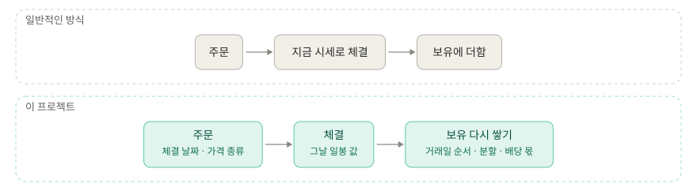

# 설계 결정 0002 — 과거 날짜로 체결한다

## 일반적인 방식

모의 투자는 지금 시세로만 체결한다. 주문 시각이 곧 체결 시각이라 보유 · 잔액이 시간 순서대로만 쌓이고, 과거를 다시 계산하지 않는다.

## 이 프로젝트

주문에 체결 날짜(`tradeDate`)와 가격 종류(`priceType`: 시가 · 종가 · 고가 · 저가 · 직접 입력)를 받아 그날의 일봉 값으로 체결한다.

- 미래 날짜는 받지 않는다. 주말은 앞 평일로 당기고, 기준 종목 시세가 그 날짜 뒤에 있으면 휴장, 없으면 수집 전으로 판단한다
- 직접 입력 가격은 그날 저가 ~ 고가 안에서만 받는다
- 과거 매도는 그날 보유와 뒤 날짜의 누적 보유까지 보고 팔 수 있는 수량을 정한다. 뒤에 판 물량을 앞 날짜에서 다시 팔지 못한다
- 과거 체결이 끼면 그 종목 보유를 거래일 순서로 다시 쌓는다. 분할 전 체결은 분할 기준으로 맞추고 배당 받을 수량도 다시 센다
- 환전은 사용자가 고른 환율을 받되, 저장된 역대 환율의 최저 · 최고에서 5% 넓힌 범위 안만 받는다

## 이유

"그때 샀으면 지금 얼마인가" 를 손으로 확인하는 것이 이 서비스의 쓰임이다. 백테스트(규칙으로 자동 매매)와 같은 과거 시세를 쓰되,
사람이 날짜를 골라 한 건씩 넣게 했다.

## 트레이드오프

- 체결 순서가 날짜 순서와 다르다. 보유 다시 쌓기 · 분할 맞추기 · 배당 몫 다시 세기 코드와 각각의 테스트를 둔다
- 과거 매도의 팔 수 있는 수량은 지금 보유가 아니라 뒤 날짜까지 본 최솟값이라 화면의 보유와 매도 가능량이 다를 때가 있다
- 수집 전 평일(장 마감 뒤 다음 날 아침 수집 전)은 시세가 없어 그날로 주문하지 못한다
- 환율을 사용자가 범위 안에서 고르므로, 좋은 환율로 환전해 원화를 불릴 수 있다. 모의 계좌이고 순위 · 보상이 없어 감수한다

## 일반적인 방식으로 바꿀 때

- 사용자끼리 수익률을 겨루는 기능(순위 · 대회)을 둘 때 — 과거 체결과 고르는 환율을 막고 지금 시세만 받는다

## 코드

- 체결 날짜 · 가격 종류: [TradeRequestDto.java](../../backend/trade-service/src/main/java/com/muscat/trade/domain/dto/request/TradeRequestDto.java) ·
  [PriceType.java](../../backend/trade-service/src/main/java/com/muscat/trade/common/enums/type/PriceType.java)
- 날짜 판단 · 직접 입력 범위: [MarketDataServiceImpl.java](../../backend/trade-service/src/main/java/com/muscat/trade/domain/service/impl/MarketDataServiceImpl.java)
- 매도 가능량: [TradingServiceImpl.java](../../backend/trade-service/src/main/java/com/muscat/trade/domain/service/impl/TradingServiceImpl.java)
- 보유 다시 쌓기 · 분할 · 배당 몫: [HoldingsRebuilder.java](../../backend/trade-service/src/main/java/com/muscat/trade/domain/service/HoldingsRebuilder.java) ·
  [StockSplitService.java](../../backend/trade-service/src/main/java/com/muscat/trade/domain/service/StockSplitService.java) ·
  [DividendEntitlement.java](../../backend/trade-service/src/main/java/com/muscat/trade/domain/service/DividendEntitlement.java)
- 환율 범위: [AccountServiceImpl.java](../../backend/user-service/src/main/java/com/muscat/user/domain/account/service/impl/AccountServiceImpl.java)
