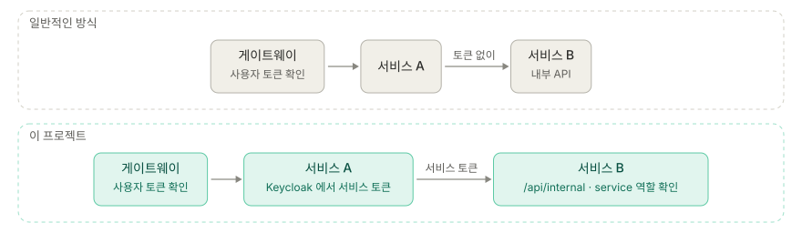

# 설계 결정 0003 — 내부 API 도 서비스 토큰으로 부른다

## 일반적인 방식

클러스터 안 서비스끼리의 호출은 믿는다. 밖에서 들어오는 요청만 게이트웨이에서 인증하고 안쪽은 NetworkPolicy 로 호출 경로만 좁힌다.
서비스가 많으면 서비스 메시의 mTLS 로 호출한 서비스를 확인한다.

## 이 프로젝트

`/api/internal/**` 는 Keycloak realm 역할 `service` 가 있는 토큰만 받는다. 부르는 서비스는 Keycloak 서비스 클라이언트로
client credentials 토큰을 받아 싣는다. NetworkPolicy 의 기본 거부와 서비스별 허용은 그대로 둔다.

- 토큰은 만료 30초 전까지 다시 쓰고 받기에 실패하면 5초 동안 다시 요청하지 않는다. 새로 받지 못해도 만료 전이면 받아 둔 토큰을 쓴다
- Feign 은 내부 경로에만 서비스 토큰을 싣고 나머지 경로에는 요청한 사용자의 토큰을 그대로 넘긴다. 서비스 토큰을 못 받으면 요청을 보내지 않는다
- 사용자 토큰은 이메일 인증이 끝난 것만 받고 서비스 토큰은 서비스 클라이언트가 낸 것만 받는다

## 이유

내부 API 는 사용자를 요청 값(Keycloak ID)으로 받는다. 경로 하나가 밖으로 열리거나 NetworkPolicy 를 잘못 바꾸면, 남의 계좌 · 보유를
ID 만으로 읽게 된다. 2026-11 점검에서 내부 경로가 토큰 없이 열린 것을 보고 바꿨다. Keycloak 을 이미 로그인에 쓰고 있어 서비스 클라이언트 ·
realm 역할 하나 · 공통 라이브러리 설정으로 막을 수 있었다. 서비스 메시는 노드 셋 · 서비스 열 개 남짓인 규모에 비해 운영할 부품이 많다.

## 트레이드오프

- 서비스 클라이언트와 secret 을 관리한다. secret 은 부르는 서비스에만 넣는다
- realm 은 Keycloak 이 처음 뜰 때만 가져온다. 새 클라이언트 · 역할은 떠 있는 Keycloak 에 손으로 넣고 빠지면 토큰 받기가 실패한다
- Keycloak 이 멈추면 받아 둔 토큰이 만료된 뒤부터 서비스 사이 호출도 멈춘다
- 호출마다 토큰 검사가 더해진다(서명 검사는 받아 둔 공개 키로 한다)

## 일반적인 방식으로 바꿀 때

- 서비스가 여러 클러스터 · 팀으로 늘어 서비스 메시를 따로 둘 때 — mTLS 로 호출한 서비스를 확인하고 사용자 단위 권한만 토큰으로 본다

## 코드

- 서비스 토큰: [ServiceTokenProvider.java](../../backend/ggeolmuse-common/src/main/java/com/muscat/commonlib/security/ServiceTokenProvider.java)
- 내부 경로 · 사용자 토큰 검사: [ServiceSecurity.java](../../backend/ggeolmuse-common/src/main/java/com/muscat/commonlib/security/ServiceSecurity.java)
- 토큰 싣기: [FeignConfig.java](../../backend/ggeolmuse-common/src/main/java/com/muscat/commonlib/config/FeignConfig.java)
- realm 의 서비스 클라이언트 · 역할: [keycloak-realm-template.json](../../infra/k8s/charts/ggeolmuse/config-files/keycloak-realm-template.json)
