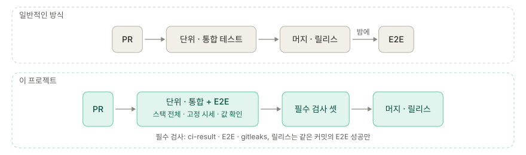

# 설계 결정 0004 — 고정 시세 E2E 를 머지 필수 검사로 둔다

## 일반적인 방식

PR 에는 단위 · 통합 테스트만 걸고 E2E 는 선택이거나 밤에 한 번 돈다. 외부 시세 같은 바깥 의존은 목으로 바꾼다. E2E 는 느리고 결과가
자주 흔들려 머지를 막는 검사로 두면 개발이 자주 멈춘다.

## 이 프로젝트

`master` 규칙에서 `ci-result` · `E2E` · `gitleaks` 셋이 통과해야 머지된다.

- E2E 는 PR 마다 스택 전체(서비스 · Keycloak · Kafka · Postgres · 프론트)를 compose 로 띄우고 Playwright 로 화면과 API 를 돈다
- market-data 는 `fixed-quotes` 프로필로 jar 안의 고정 데이터를 쓴다. 종목 셋(FQA · FQB · SPY), 2023-07-03 ~ 2025-06-30 의 500 거래일, 같은 기간 환율이다
- 값까지 본다. 매수 · 매도 금액, 계좌 통계(수익 흐름 · 배당 · 환율 · 거래 패턴), 백테스트 결과가 고정 데이터로 계산한 값과 같은지 확인한다
- 릴리스는 `ci-result` · `E2E` 가 성공한 커밋만 빌드한다. 문서 · 차트 · 인프라만 바뀐 PR 은 E2E 를 건너뛴다

## 이유

한 화면의 숫자가 서비스 셋 이상을 거쳐 나온다(주문 → 체결 이벤트 → 정산 → 통계). 단위 테스트는 각 서비스 안을 보고, 이벤트 순서 ·
환율 · 반올림이 어긋나면 화면 숫자만 틀린다. 외부 시세를 고정 데이터로 바꿔 매번 같은 숫자가 나오게 했다. 그래서 값까지 확인한다.
머지가 곧 운영 반영이라 머지 전에 막지 않으면 틀린 숫자가 바로 운영에 나간다.

## 트레이드오프

- 서비스 코드를 바꾼 PR 마다 E2E 잡이 6 ~ 9분 더 걸리고 러너 시간이 든다
- Docker Hub 받기 한도(429)나 스택 기동이 늦어 실패하면 다시 돌린다. 기동을 기다리는 단계(고정 종목 셋 모두에 가격이 생길 때까지)를 두었다
- 고정 데이터에 없는 종목 · 기간 · 외부 연동(실제 시세 수집 · AI 대화의 LLM)은 E2E 밖이다

## 일반적인 방식으로 바꿀 때

- E2E 가 10분을 넘거나 흔들려서 다시 돌리는 일이 잦을 때 — 흐름별로 나눠 바뀐 서비스에 닿는 것만 필수로 두고 나머지는 밤 실행으로 옮긴다

## 코드

- 필수 검사 · 건너뛰기: [ci.yml](../../.github/workflows/ci.yml) · [ci-changes](../../tools/cmd/ci-changes/main.go)
- 고정 시세 스택: [docker-compose.e2e.yml](../../infra/compose/docker-compose.e2e.yml) ·
  [fixed-quotes](../../backend/market-data-service/src/main/resources/fixed-quotes/)
- 흐름 · 값 확인: [E2E README](../../tests/e2e/README.md) · [tests](../../tests/e2e/tests/)
- 릴리스가 고르는 커밋: [release.yml](../../.github/workflows/release.yml)
