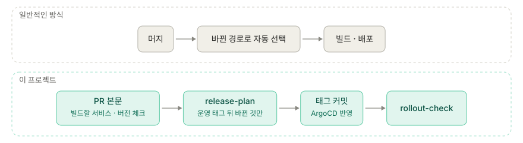

# 설계 결정 0005 — 릴리스할 서비스는 PR 본문에서 사람이 고른다

## 일반적인 방식

모노레포는 바뀐 경로로 릴리스할 서비스를 자동으로 고른다(경로 필터 · 빌드 도구의 영향 그래프). 서비스마다 리포를 두고 리포마다 따로
릴리스하는 방식도 흔하다.

## 이 프로젝트

PR 본문의 "빌드할 서비스" 칸에서 사람이 체크하고 버전을 옆에 적는다(비우면 커밋 SHA 7자리).

- master 에 머지된 뒤 CI · E2E 가 통과하면 릴리스가 같은 커밋으로 이어진다
- `release-plan` 이 체크한 서비스 가운데 운영 태그 뒤로 바뀐 것만 고른다. 체크했어도 바뀌지 않았으면 내지 않는다
- 릴리스 봇이 운영 값 파일의 이미지 태그와 Config Server 가 읽을 설정 리포 커밋을 같이 바꿔 master 에 커밋하고 ArgoCD 가 그 커밋을 반영한다
- 반영 뒤 `rollout-check` 가 ArgoCD 상태 · 서비스별 이미지 · 공개 주소 응답을 확인한다
- PR 의 CI 는 바뀐 경로로 고른 서비스만 빌드 · 테스트한다. 경로로 고르는 것은 검사에만 쓰고 릴리스에는 쓰지 않는다

## 이유

공용 모듈(`ggeolmuse-common`) · BOM · 메시지 라이브러리 · 설정 키 변경은 경로 밖에서 서비스를 바꾼다. 공용 모듈의 한 줄이 여섯 서비스 중
어디에 닿는지는 경로만으로 모르고 다 내면 바뀌지 않은 서비스까지 재시작한다. 낼 서비스는 PR 을 쓴 사람이 고르고 도구는 운영 태그 뒤로
정말 바뀌었는지만 거른다. 서비스마다 리포를 두면 공용 모듈에 버전을 매겨 내고 서비스마다 올리는 일이 생긴다.

## 트레이드오프

- 체크를 빠뜨리면 그 서비스는 나가지 않는다. 머지 뒤 서비스 · 버전을 적어 손으로 돌린다(필수 검사가 통과한 가장 최근 master 커밋으로)
- 버전은 그 서비스의 이전 최고 버전보다 높게 적는다. 같거나 낮으면 릴리스가 멈춘다
- 운영 시간 밖에 머지하면 반영 확인을 건너뛰고 다음 기동 때 반영된다

## 일반적인 방식으로 바꿀 때

- 서비스가 늘어 체크를 자주 빠뜨릴 때 — 바뀐 경로 · 모듈 의존으로 후보를 미리 채우고 사람은 지우기만 한다

## 코드

- 빌드할 서비스 칸: [pull_request_template.md](../../.github/pull_request_template.md)
- 고르기 · 태그 바꾸기 · 반영 확인: [release-plan](../../tools/cmd/release-plan) · [set-image-tag](../../tools/cmd/set-image-tag) ·
  [rollout-check](../../tools/cmd/rollout-check)
- 릴리스 흐름: [release.yml](../../.github/workflows/release.yml)
- PR 의 바뀐 서비스만 검사: [ci-changes](../../tools/cmd/ci-changes/main.go)
