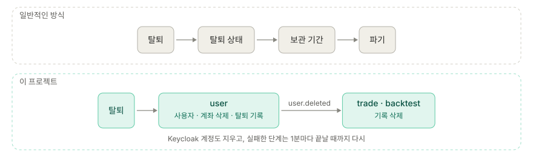

# 설계 결정 0006 — 탈퇴는 바로 완전히 지우고, 지운 사실만 기록한다

## 일반적인 방식

탈퇴하면 계정을 "탈퇴 상태" 로 바꾸고(소프트 삭제), 법이나 약관이 정한 기간 동안 보관한 뒤 파기한다.

## 이 프로젝트

탈퇴하면 그 자리에서 지운다.

- user-service 가 한 트랜잭션에서 사용자 · 계좌 · 계좌 이력을 지우고 탈퇴 기록(`user_deletions`: Keycloak ID · 지운 시각 ·
  이벤트를 보낸 시각 · Keycloak 계정을 지운 시각)을 남긴다
- 커밋 뒤 `user.deleted` 를 보내고 Keycloak 계정을 지운다. 실패한 단계는 파드 하나가 1분마다 끝날 때까지 다시 하고 끝난 기록은 하루 뒤 지운다
- trade-service 와 backtest-service 가 `user.deleted` 를 받아 체결 · 보유 · 통계와 백테스트 이력을 지운다
- 탈퇴 기록이 남은 동안은 아직 만료되지 않은 토큰으로 요청이 와도 사용자를 다시 만들지 않고 `USER_NOT_FOUND` 로 답한다

## 이유

모의 투자라 거래 기록을 보관할 법적 · 회계적 이유가 없다. 남길 이유가 없는 개인 데이터는 두지 않는다. 서비스 셋에 나뉜 데이터를
한 번에 지울 수 없어 지운 사실을 기록하고 이벤트로 넘긴 뒤 끝날 때까지 다시 하게 했다.

## 트레이드오프

- 되돌릴 수 없다. 실수로 탈퇴해도 데이터를 되살리는 길이 없다(백업 복원은 DB 전체 단위)
- 지운 데이터가 백업에는 남는다. RDS 자동 백업 7일, 월간 덤프 400일, `user.deleted` 토픽 30일, 로그 7일이다
- AI 대화 기록은 Redis 에 대화마다 5시간 남았다가 만료로 사라지고 탈퇴 때 따로 지우지 않는다
- 서비스 사이 지우기가 이벤트라 받는 서비스가 멈춰 있으면 그 서비스의 데이터는 다시 뜰 때 지워진다

## 일반적인 방식으로 바꿀 때

- 실제 돈 · 결제 · 보관 의무가 있는 기능이 들어올 때 — 보관 기간을 정한 소프트 삭제로 바꾼다

## 코드

- 탈퇴 · 기록: [UserServiceImpl.java](../../backend/user-service/src/main/java/com/muscat/user/domain/user/service/impl/UserServiceImpl.java) ·
  [UserDeletionCleaner.java](../../backend/user-service/src/main/java/com/muscat/user/domain/user/service/UserDeletionCleaner.java) ·
  [V13__Create_User_Deletions.sql](../../backend/user-service/src/main/resources/db/migration/V13__Create_User_Deletions.sql)
- 받는 쪽: [trade 의 UserDeletedEventConsumer.java](../../backend/trade-service/src/main/java/com/muscat/trade/infra/kafka/UserDeletedEventConsumer.java) ·
  [backtest 의 UserDeletedEventConsumer.java](../../backend/backtest-service/src/main/java/com/muscat/backtest/infra/kafka/UserDeletedEventConsumer.java)
- 보존 기간: [kafka-topics.yaml](../../infra/k8s/charts/ggeolmuse/templates/infrastructure/kafka-topics.yaml) ·
  [loki-values.yaml](../../infra/k8s/monitoring/loki-values.yaml) · [variables.tf](../../infra/terraform/ops/variables.tf) ·
  [chat-service config.py](../../backend/chat-service/app/config.py)
