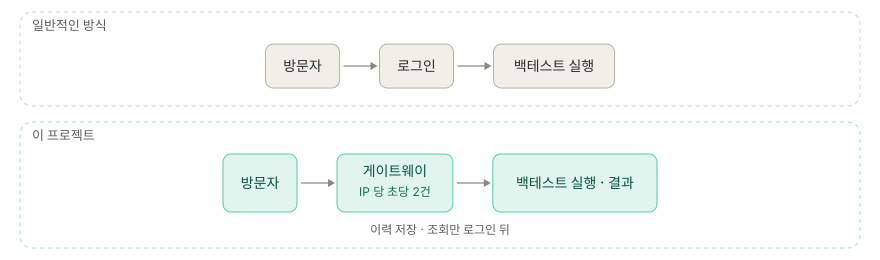

# 설계 결정 0007 — 백테스트는 로그인 없이 연다

## 일반적인 방식

서버 자원을 많이 쓰는 기능은 로그인 뒤에 둔다. 계정 단위로 사용량을 세고 막을 수 있고 남용은 계정 정지로 막는다.

## 이 프로젝트

백테스트 실행(`POST /api/trading-simulation/**`)과 분석(`POST /api/analysis/**`)은 로그인 없이 받는다.

- 결과 화면까지는 로그인 없이 본다. 이력 저장 · 조회(`/api/backtest/**`)만 로그인 뒤다
- 게이트웨이가 IP 마다 초당 2건, 한꺼번에 4건까지만 받는다(요청 하나가 토큰 10개, 초당 20개 채움 · 최대 40개)
- IP 는 Cloudflare 가 넘기는 접속 주소로 센다
- 시세 조회(`GET /api/market/**`)도 로그인 없이 열려 있다

## 이유

처음 들어온 사람이 가입 없이 "이 종목을 이 기간 이렇게 샀으면" 을 바로 돌려 보게 하는 것이 첫 화면의 목적이다. 계산은 저장된 일봉으로만
하고 외부 유료 API 를 부르지 않아 남용돼도 드는 것은 클러스터 CPU 뿐이다. 그래서 계정 대신 IP 당 요청 한도로 막았다.

## 트레이드오프

- 무거운 계산을 막는 것은 IP 한도와 서킷 브레이커뿐이다. 여러 IP 에서 한꺼번에 오면 백테스트 레플리카 둘이 처리하는 만큼만 받고
  나머지는 늦어지거나 실패한다
- 로그인하지 않은 실행은 이력이 남지 않는다. 같은 설정으로 다시 돌릴 때는 값을 다시 넣는다
- 실행량을 계정 단위로는 모르고 IP 와 지표로만 본다

## 일반적인 방식으로 바꿀 때

- 백테스트가 외부 유료 API(실시간 시세 · LLM)를 부르게 될 때, 또는 IP 한도로 막지 못하는 남용이 지표에 보일 때 — 실행도 로그인 뒤로 옮긴다

## 코드

- 열린 경로: [SecurityConfig.java](../../backend/gateway-server/src/main/java/com/muscat/gateway/config/SecurityConfig.java)
- IP 세기: [RateLimiterConfig.java](../../backend/gateway-server/src/main/java/com/muscat/gateway/config/RateLimiterConfig.java)
- IP 당 한도 · 서킷 브레이커: 설정 리포 [ggeolmuse-config](https://github.com/musqat/ggeolmuse-config) 의 `gateway-server.yml` 의 `backtest-route`
- 로그인 없는 실행 · 이력 막힘 확인: [E2E README](../../tests/e2e/README.md) 의 `public-backtest`
