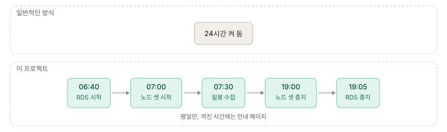

# 설계 결정 0008 — 평일 07 ~ 19시에만 켠다

## 일반적인 방식

웹 서비스는 24시간 켜 둔다. 배포 · 배치 · 알림도 늘 떠 있는 서버를 전제로 한다.

## 이 프로젝트

EventBridge Scheduler 가 평일(MON-FRI)에만 켜고 끈다(Asia/Seoul).

| 시각 | 일 |
|---|---|
| 06:40 | RDS 시작 |
| 07:00 | 노드 셋 시작(컨트롤 플레인 · 워커 둘) |
| 07:20 | 아침 기동 확인(슬랙) · 가동 확인 시작(5분마다 프론트 · 시세 API · `/auth`) |
| 07:30 | 일봉 수집 |
| 19:00 | 노드 셋 중지 |
| 19:05 | RDS 중지 |

- 꺼진 시간에 들어오면 Cloudflare Worker 가 "운영 시간이 아님" 안내와 다음 가동 시각을 503 으로 준다(Cloudflare 가 origin 에 못 닿은 52x ·
  Tunnel 에 연결된 cloudflared 가 없는 530 만, 앱이 낸 5xx 는 그대로)
- 꺼진 시간에 머지된 릴리스는 반영 확인을 건너뛰고, 다음 기동 때 ArgoCD 가 반영한다

## 이유

비용이다. 켜 둔 시간이 주 60시간으로 24시간 운영(주 168시간)의 36% 다. 인스턴스 · RDS 사용 시간 요금이 거의 그 비율로 준다
(디스크 · RDS 저장 공간 · 스냅숏은 꺼져도 든다). 지금 사용자는 만든 사람과 확인하는 사람뿐이다.

## 트레이드오프

- 밤 · 주말에는 서비스가 없고 안내 페이지만 보인다
- 기동 순서를 시각으로 맞춘다. RDS 를 20분 먼저 켜고 수집은 앱이 다 뜬 뒤인 07:30 에 돈다. 노드 셋이 같이 뜰 때 자바 앱 기동이 겹쳐
  기동 검사 허용 시간을 10분으로 두었다
- 운영 시간 밖에 머지하면 반영 확인이 다음 기동까지 미뤄진다
- 월요일 아침은 주말 사이 일봉을 한 번에 받는다. 수집 전 평일 날짜로는 주문하지 못한다([설계 결정 0002](0002-backdated-trades.md))

## 일반적인 방식으로 바꿀 때

- 운영자 말고 실제 사용자가 생길 때 — 24시간으로 바꾸고 비용은 노드 종류 · 레플리카 수로 맞춘다

## 코드

- 일정: [scheduler.tf](../../infra/terraform/ops/scheduler.tf) · [rds-scheduler.tf](../../infra/terraform/ops/rds-scheduler.tf) ·
  [variables.tf](../../infra/terraform/ops/variables.tf)(`scheduler_start_hour` · `scheduler_stop_hour` · `rds_start_hour` · `rds_start_minute` ·
  `rds_stop_hour` · `rds_stop_minute`)
- 가동 확인: [uptime-check.tf](../../infra/terraform/ops/uptime-check.tf)
- 아침 기동 확인: [morning-check.yaml](../../infra/k8s/charts/ggeolmuse/templates/monitoring/morning-check.yaml)
- 안내 페이지: [worker.js](../../infra/cloudflare/offline-notice/worker.js)
- 반영 확인 건너뜀: [rollout-check public.go](../../tools/cmd/rollout-check/public.go)
- 일봉 수집 시각: 설정 리포 [ggeolmuse-config](https://github.com/musqat/ggeolmuse-config) 의 `market-data-service.yml`
