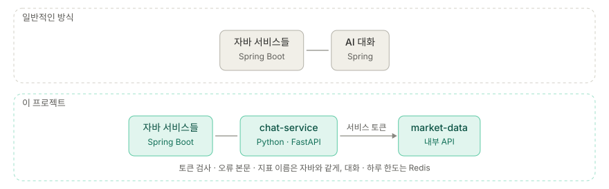

# 설계 결정 0009 — AI 대화만 Python 으로 둔다

## 일반적인 방식

백엔드를 한 언어 · 한 프레임워크로 맞춘다. 빌드 · 테스트 · 공용 모듈 · 이미지 검사를 한 가지로 관리한다. 다른 백엔드가 모두
Java · Spring Boot 인 이 리포라면 AI 대화도 Spring(Spring AI 등)으로 만든다.

## 이 프로젝트

chat-service 하나만 Python(FastAPI 비동기 + 공식 `openai` SDK)이다. 경계는 자바 서비스와 같게 맞췄다.

- 사용자 토큰은 같은 허용 목록(발급자 · 클라이언트 · 이메일 인증)으로 검사한다
- 시세는 market-data 내부 API 를 서비스 토큰으로 부른다([설계 결정 0003](0003-service-tokens.md))
- 오류 본문은 같은 ProblemDetail(`errorCode` · `detail`)이다
- 요청 지표의 이름 · 레이블을 자바(`http_server_requests_seconds`)와 맞춰 같은 대시보드에 들어간다
- DB 를 두지 않는다. 대화(최근 3턴, 5시간)와 하루 한도는 Redis 에 둔다

## 이유

Spring 에서 LLM 을 부르는 것보다 Python 서비스를 하나 두는 쪽이 간편했고 Python 으로 LLM 을 부르는 방법을 익혀 둔 것을 써 보려고
골랐다. 요청 하나가 시세 조회 한 번과 LLM 호출 두 번(스킬 고르기 · 답)을 기다리는 일이라 처리 시간 대부분이 바깥 응답 대기다.
비동기 FastAPI 로 받아 파드 하나가 요청 128Mi · 한도 512Mi 로 돈다.

## 트레이드오프

- 빌드 · 테스트 도구를 따로 둔다. pytest · 커버리지 · Dockerfile 과 CI 커버리지 검사(`tools/cmd/chat-coverage`)가 자바와 별개다
- 공용 모듈이 하는 토큰 검사 · 서비스 토큰 · 오류 응답을 Python 으로 다시 만들어 규칙이 바뀌면 두 곳을 같이 고친다
- 대화 기록이 Redis 의 만료로만 사라진다. 탈퇴해도 마지막 답 뒤 5시간은 남는다([설계 결정 0006](0006-account-deletion.md))

## 일반적인 방식으로 바꿀 때

- 자바 쪽 라이브러리로 같은 일을 할 이유가 생기거나, 따로 관리하는 일이 기능 개발보다 많아질 때 — 경계(API · 오류 · 지표)는 그대로 두고
  안만 옮긴다

## 코드

- 구조 · 처리 흐름: [chat-service README](../../backend/chat-service/README.md)
- 토큰 검사 · 서비스 토큰 · 지표: [jwks.py](../../backend/chat-service/app/infra/jwks.py) ·
  [service_token.py](../../backend/chat-service/app/infra/service_token.py) · [metrics.py](../../backend/chat-service/app/infra/metrics.py)
- 오류 응답: [errors.py](../../backend/chat-service/app/api/errors.py)
- 대화 보관 · 하루 한도: [conversations.py](../../backend/chat-service/app/infra/conversations.py) ·
  [quota.py](../../backend/chat-service/app/infra/quota.py) · [config.py](../../backend/chat-service/app/config.py)
