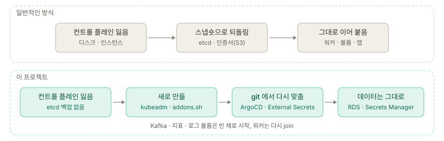

# 설계 결정 0010 — 컨트롤 플레인을 잃으면 백업에서 되돌리지 않고 새로 만든다

## 일반적인 방식

kubeadm 으로 컨트롤 플레인을 직접 운영하면 etcd 스냅숏과 인증서(`/etc/kubernetes/pki`)를 주기적으로 클러스터 밖에 둔다. 컨트롤 플레인을
잃으면 그 스냅숏으로 etcd 를 되돌리고, 워커와 볼륨은 그대로 이어 붙는다.

## 이 프로젝트

etcd 는 백업하지 않는다. 컨트롤 플레인 1대를 잃으면 클러스터를 새로 만들고, 상태는 아래 원본에서 다시 받는다.

| 무엇 | 원본 | 새로 만들 때 |
|---|---|---|
| 업무 데이터(계좌 · 거래 · 시세 · 백테스트 · Keycloak) | RDS | 그대로 |
| 앱 · 모니터링 매니페스트 | git | ArgoCD 가 다시 맞춤 |
| 시크릿 값 | AWS Secrets Manager | External Secrets 가 다시 받음 |
| 클러스터 부품(Calico · metrics-server · Envoy Gateway · EBS CSI · External Secrets · ArgoCD) | git(`addons.sh` · `versions.env`) | 스크립트 한 번 |
| Kafka · ZooKeeper 볼륨 | 없음 | 빈 볼륨으로 시작(토픽 · 오프셋 새로) |
| 지표 · 로그 · 트레이스 볼륨 | 없음 | 빈 볼륨으로 시작 |

- 클러스터 안에만 있는 상태는 Kafka 의 처리 중 이벤트와 관측 기록이다. 둘 다 잃어도 업무 데이터는 맞다
- 컨트롤 플레인이 멈추기만 하면 떠 있는 파드는 계속 돈다. 배포 · 변경만 멈춘다

## 이유

etcd 에만 있고 잃으면 안 되는 것이 없다. 반대로 백업을 두면 지킬 것이 생긴다.

- etcd 저장 암호화를 켜지 않아 스냅숏에 Secret 이 평문으로 들어간다. 보관 버킷의 읽기 권한이 곧 모든 시크릿의 읽기 권한이 된다
- 스냅숏만으로는 새 컨트롤 플레인에서 되살릴 수 없어 CA 개인 키도 같이 둬야 한다. 클러스터 전체를 위조할 수 있는 키가 하나 더 밖에 나간다
- 복원은 해 보지 않으면 되는지 모른다. 백업 실패 알림과 복원 리허설이 일로 붙는다

새로 만드는 데 드는 것은 반나절 안팎의 중단이고, 사용자는 만든 사람과 확인하는 사람뿐이다([설계 결정 0008](0008-weekday-hours.md)).

## 트레이드오프

- 컨트롤 플레인을 잃으면 다시 만드는 동안 사이트가 멈춘다. 스냅숏 복원이면 수십 분이다
- 그 순간 아직 소비되지 않은 Kafka 이벤트(체결 결과 · 정산 등)를 잃는다. 소비자가 다 읽은 뒤면 잃는 이벤트가 없다
- 지표 · 로그 이력이 끊긴다
- 워커 둘도 다시 join 한다(새 CA)

## 일반적인 방식으로 바꿀 때

- 클러스터 안에 잃으면 안 되는 상태가 생길 때 — 예를 들어 Kafka 를 이벤트 원본으로 오래 두거나, RDS 밖의 저장소를 클러스터 볼륨에 둘 때
- 실제 사용자가 생겨 중단 시간이 비용이 될 때 — etcd 스냅숏 · 인증서를 쓰기만 되는 버킷에 두고 복원 리허설을 하거나, 컨트롤 플레인을
  EKS 로 넘긴다

## 코드

- 클러스터 부품: [addons.sh](../../infra/k8s/bootstrap/addons.sh) · [versions.env](../../infra/k8s/versions.env)
- 컨트롤 플레인 설정: [kubeadm-config.yaml](../../infra/k8s/bootstrap/kubeadm-config.yaml) · [control-plane.sh](../../infra/k8s/bootstrap/control-plane.sh)
- ArgoCD 루트 앱: [root.yaml](../../infra/k8s/argocd/root.yaml)
- 시크릿: [secretstore.yaml](../../infra/k8s/charts/ggeolmuse/templates/secrets/secretstore.yaml) ·
  [externalsecret.yaml](../../infra/k8s/charts/ggeolmuse/templates/secrets/externalsecret.yaml)
- Kafka · ZooKeeper 볼륨: [values-prod.yaml](../../infra/k8s/charts/ggeolmuse/values-prod.yaml)(`infrastructure.kafka.storage` · `infrastructure.zookeeper.storage`)
- 노드: [main.tf](../../infra/terraform/cluster/modules/k8s-cluster/main.tf)
