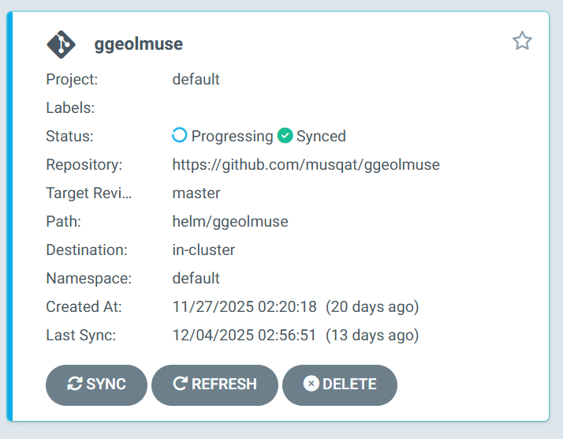
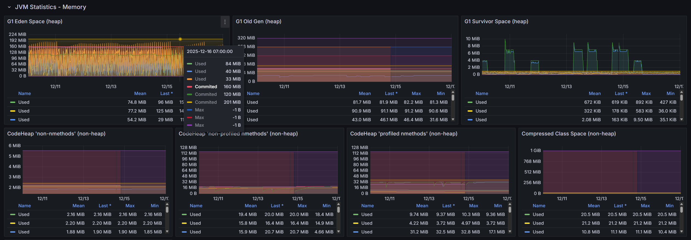

# Infrastructure & Deployment

## 인프라 아키텍처

### AWS 구성

```
AWS EC2 (t3a.xlarge, 16GB RAM)
├── Cloudflare (DNS, SSL, DDoS 방어)
│
└── K3s Cluster
    │
    ├── Ingress (Traefik)
    │
    ├── GitOps
    │   └── ArgoCD
    │
    ├── Monitoring Stack
    │   ├── Prometheus (메트릭 수집)
    │   ├── Grafana (시각화)
    │   ├── Loki (로그 집계)
    │   ├── Tempo (분산 추적)
    │   └── OpenTelemetry (계측)
    │
    ├── Infrastructure Pods
    │   ├── Kafka + Zookeeper (이벤트 버스)
    │   ├── Redis (캐시)
    │   └── Keycloak (인증)
    │
    └── Application Pods
        ├── gateway-server
        ├── config-server
        ├── user-service
        ├── trade-service
        ├── market-data-service
        ├── backtest-service
        ├── chat-service
        └── frontend

AWS RDS (db.t3.micro)
└── PostgreSQL (Single-AZ)
```

### 외부 서비스

| 서비스 | 용도 | 비고 |
|--------|------|------|
| Cloudflare | DNS, SSL, CDN | 무료 플랜 |
| RDS PostgreSQL | 데이터베이스 | db.t3.micro, Single-AZ |
| Route 53 | 도메인 관리 | 호스팅 영역 |
| Secrets Manager | 시크릿 관리 | API 키, DB 비밀번호 |

---

## 구성 등급 선택

### 초기 계획 vs 최종 선택

| 구성 | 초기 계획 | 최종 선택 |
|------|----------|----------|
| Kubernetes | EKS | K3s (EC2 단일 노드) |
| Database | RDS Multi-AZ | RDS Single-AZ |
| Cache | ElastiCache | 파드 내 Redis |
| Message Queue | MSK | 파드 내 Kafka |
| Load Balancer | ALB | Cloudflare |

### 선택 근거

**상황**: 개인 프로젝트, 트래픽 적음

**트레이드오프**:
| 포기한 것 | 유지한 것 |
|----------|----------|
| 고가용성 (Multi-AZ) | 마이크로서비스 구조 |
| 자동 스케일링 | 컨테이너화 (Docker + K8s) |
| 관리형 서비스 (EKS, MSK) | Event-Driven 아키텍처 |
| 무중단 배포 | 모니터링 (Grafana Stack) |

**스케일업 경로**:
```
K3s 단일 노드
  ↓ 트래픽 증가 시
EC2 스펙 업그레이드
  ↓ 더 증가 시
EKS + Multi-Node
  ↓ 본격 서비스 시
EKS + RDS Multi-AZ + ElastiCache
```
values 파일만 수정하면 EKS 전환 가능.

---

## CI/CD 파이프라인

### 전체 흐름

```
코드 푸시 · PR (GitHub)
    │
    ▼
GitHub Actions (CI)
    ├── 서비스 빌드 · 테스트 · 커버리지 최소치 검사
    ├── Docker 이미지 빌드 → Trivy 스캔 (푸시하지 않음)
    └── E2E (docker compose)
    │
    ▼
릴리스
    ├── master 에서 이미지 빌드 → Docker Hub (muscathan/*) 푸시
    └── values-prod.yaml 이미지 태그 PR
    │
    ▼
ArgoCD (CD)
    ├── master 의 helm/ggeolmuse 변경 감지 (자동 동기화)
    └── Helm 배포 → K3s 클러스터
```

### Values 구조 (환경 분리)

```
values.yaml             공통 (환경 무관: 이미지 레지스트리, 포트, kafka, 토픽, probe/resource 기본값)
values-dev.yaml         로컬/dev 환경 설정 (app.localhost, Traefik Ingress, aws off, dev 프로파일) — 커밋함
values-prod.yaml        prod 환경 설정 (ggeolmuse.com, traefik, AWS Secrets Manager, prod 프로파일/리소스) — 커밋함
values-secret.yaml      로컬 시크릿 (secrets.enabled + 실제 키) — gitignore, .example 참고해 각자 생성
```

- 배포 시 반드시 환경 파일 지정:
  - 로컬: `helm ... -f values-dev.yaml -f values-secret.yaml` (환경설정 + 로컬시크릿)
  - 운영: `helm ... -f values-prod.yaml` (ArgoCD가 사용, 시크릿은 AWS Secrets Manager)
- `values.yaml`은 공통만 담으므로 단독 사용(no -f) 시 도메인/ingress 등이 비어 불완전.
- 이미지 tag: `values.yaml`은 tag 미지정 → `Chart.AppVersion` 일괄 사용(로컬), prod는 서비스별 명시.

### 로컬 빌드 & 배포

> 멀티 노드와 같은 모양(3노드 · Calico · Traefik · 시크릿 파일)은 kind 로 띄운다 → [`../k8s/README.md`](../k8s/README.md#로컬-kind-3노드).
> 아래는 docker-desktop 단일 노드 기준(Ingress 컨트롤러는 Traefik 을 따로 깔거나 port-forward).

> 전제: 로컬 Kubernetes(docker-desktop 등) + Docker + helm. 이미지는 로컬 빌드해 `Chart.AppVersion` 태그로 사용.

**1. 시크릿 파일 준비** (최초 1회)
```bash
cp helm/ggeolmuse/values-secret.yaml.example helm/ggeolmuse/values-secret.yaml
# values-secret.yaml 열어 실제 키 입력 (OPENAI_API_KEY 등). gitignore라 커밋 안 됨.
```

**2. 이미지 빌드** (`Chart.AppVersion`과 동일 태그로)
```bash
# Java 6개 — 멀티스테이지, 컨텍스트는 레포 루트
for svc in config-server gateway-server user-service trade-service market-data-service backtest-service; do
  docker build -f backend/$svc/Dockerfile -t muscathan/$svc:1.2.0 .
done

# chat-service (Python) — 컨텍스트는 자기 폴더
docker build -t muscathan/chat-service:1.2.0 backend/chat-service

# frontend-web — 컨텍스트는 자기 폴더
docker build -t muscathan/frontend-web:1.2.0 frontend-web
```
> 태그(`1.2.0`)는 `helm/ggeolmuse/Chart.yaml`의 `appVersion`과 일치시킨다. base values는 tag 미지정 → 이 값 사용.

**3. helm 배포**
```bash
helm upgrade --install ggeolmuse helm/ggeolmuse \
  -f helm/ggeolmuse/values-dev.yaml \
  -f helm/ggeolmuse/values-secret.yaml
```
> dev 는 Traefik IngressRoute · Prometheus ServiceMonitor 를 렌더하지 않아(CRD 불필요) docker-desktop Kubernetes 에 그대로 설치된다. 진입은 표준 Ingress(`ingress.hosts`), prod 는 IngressRoute.

**4. 접속**
```bash
# Traefik 이 있으면: http://app.localhost
# 없으면 port-forward
kubectl port-forward svc/frontend-web 3000:3000   # 프론트
kubectl port-forward svc/gateway-server 8070:8070 # API
```

> 코드 수정 후 재배포: 고친 서비스만 다시 `docker build` → `helm upgrade ...` 또는 `kubectl rollout restart deployment/<svc>`.

### ArgoCD GitOps

master 의 `helm/ggeolmuse` 가 바뀌면(이미지 태그는 values-prod.yaml) ArgoCD 가 자동으로 맞춘다. 리포에서 지운 리소스는 클러스터에서도 지우고(prune),
클러스터에서 손으로 바꾼 것은 되돌린다(selfHeal).

<div align="center">
  
</div>

운영 k3s 의 Application 은 모두 리포에 있다.

| Application | 정의 | 동기화 |
|---|---|---|
| `ggeolmuse` | `argocd/application-ggeolmuse.yaml`(앱 차트, `values-prod.yaml`) | 자동 |
| `argocd` | `argocd/application-argocd.yaml`(ArgoCD 자신) | 수동 |
| `k3s-apps` | `argocd/root.yaml`(아래 부품 Application 묶음 `argocd/apps`) | 자동(목록만) |
| `external-secrets` · `prometheus` · `loki` · `tempo` · `k3s-traefik` | `argocd/apps/values.yaml`(차트 버전 고정, 값 파일은 `monitoring/` · `k3s-traefik/`) | 수동 |

노드를 새로 세울 때는 [`k3s-node/bootstrap.sh`](k3s-node/README.md#노드-세우기)가 ArgoCD 를 깔고 이 Application 들을 만든다.
부품은 `external-secrets` → `prometheus` → `loki` · `tempo` → `k3s-traefik` 순서로 Sync 한다(앱 차트의 SecretStore 와
Traefik PodMonitor 가 앞 부품의 CRD 를 씀).

**손으로 설치한 부품을 넘겨받을 때(한 번)** — 지금 노드의 부품은 손으로 설치돼 있다.

1. `helm list -A` 의 부품 릴리스 이름 · 네임스페이스 · 차트 버전이 `argocd/apps/values.yaml` 과 다르면 먼저 values 를 설치된 릴리스에 맞춰 머지한다(넘겨받기와 올리기를 나눔)
2. `kubectl apply -f helm/argocd/root.yaml`
3. Application 마다 ArgoCD 화면의 차이(App Diff)가 추적 어노테이션 · 레이블 정도인지 보고 Sync 한다
4. 넘겨받은 뒤에는 `helm upgrade` 대신 ArgoCD 에서 Sync 한다(`helm uninstall` 은 ArgoCD 가 맞추는 리소스까지 지움)

멀티 노드 k8s 의 앱 차트 · Application 목록 · 모니터링 값은 [`k8s/`](../k8s/README.md) 에 따로 있다.

---

## 모니터링

### Observability Stack

| 도구 | 역할 | 용도 |
|------|------|------|
| **Prometheus** | 메트릭 수집 | JVM, API 응답 시간, 에러율 |
| **Grafana** | 시각화 | 대시보드, 알림 |
| **Loki** | 로그 집계 | 에러 로그 검색, 디버깅 |
| **Tempo** | 분산 추적 | 서비스 간 요청 흐름 추적 |
| **OpenTelemetry** | 계측 | Trace/Metric 데이터 수집 및 전송 |

### Grafana - JVM 메트릭

<div align="center">
  
</div>

G1 GC 힙 메모리 사용량 모니터링 (Eden, Old Gen, Survivor Space)

### 주요 메트릭

```promql
# API 응답 시간 (P95)
histogram_quantile(0.95, rate(http_server_requests_seconds_bucket[5m]))

# 에러율 (%)
sum(rate(http_server_requests_seconds_count{status=~"5.."}[5m]))
/ sum(rate(http_server_requests_seconds_count[5m])) * 100

# JVM 힙 사용률
jvm_memory_used_bytes{area="heap"} / jvm_memory_max_bytes{area="heap"} * 100
```

---

## 트러블슈팅

### Rolling Update 중 OOM 발생

| 항목 | 내용 |
|------|------|
| **문제** | `helm upgrade` 실행 후 EC2 응답 불능 |
| **원인** | Kubernetes 기본 `maxSurge: 25%`로 배포 중 Pod 추가 생성 → 메모리 급증 |
| **해결** | `maxSurge: 0`, `maxUnavailable: 1`로 변경 |
| **지금** | 09-10 에 `maxUnavailable: 0`, `maxSurge: 1` 로 바꿨다. `maxSurge: 0` 은 옛 파드를 먼저 내려 새 파드가 준비될 때까지(readiness 약 3분) 엔드포인트가 비었다. 새 파드가 준비된 뒤 옛 파드를 내린다 |

```yaml
# values.yaml (서비스마다)
strategy:
  rollingUpdate:
    maxUnavailable: 0  # 새 파드가 준비된 뒤 옛 파드를 내림
    maxSurge: 1        # 여분 파드 하나
```

### JVM 메모리 과다 할당

| 항목 | 내용 |
|------|------|
| **문제** | t3.xlarge (16GB)에서도 메모리 부족 |
| **원인** | JVM 힙 미설정 → 컨테이너 메모리의 25% 기본 사용 |
| **분석** | Actuator metrics로 실측 → 실제 사용량 대비 5배 과다 할당 |

```bash
# 실측 결과
user-service: 실제 151MB 사용 중인데 768MB 할당
trade-service: 실제 150MB 사용 중인데 768MB 할당
gateway: 실제 75MB 사용 중인데 384MB 할당
```

| 서비스 | 기존 -Xmx | 최적화 -Xmx |
|--------|----------|-------------|
| market-data | 1024m | 768m |
| user-service | 768m | 256m |
| trade-service | 768m | 256m |
| backtest | 640m | 320m |
| gateway | 384m | 192m |
| config-server | 256m | 128m |

**결과**: t3.xlarge → t3.large 로 내렸다. 실제로 쓰는 양이 그만큼이었다. 08-31 에 t3a.xlarge(16GB)로 다시 올렸다.
